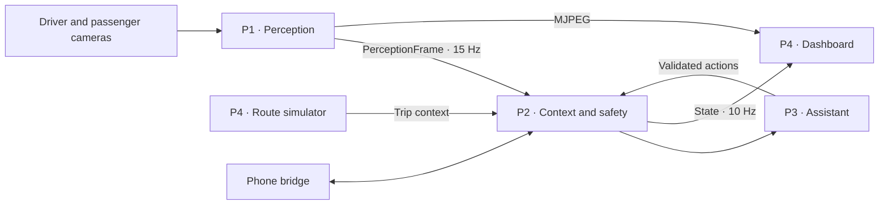

# DriveMate

<picture>
  <source media="(prefers-color-scheme: dark)" srcset="dashboard/public/brand/drivemate_full_dark.svg">
  
</picture>

AI driver-monitoring copilot built at **CodeLap Hackathon 2026, AI Drive track**, with a **2016 Škoda Rapid** as the demo vehicle.

DriveMate combines camera observations, trip context and deterministic safety rules with a voice assistant. It watches for fatigue and distraction, offers relevant help and lets the driver choose how often the assistant speaks. Critical safety decisions take priority over conversation.

## Features

- Eye closure, gaze, head pose, phone use, gestures and occupant observations from two cameras.
- Attention, fatigue, disengagement, reaction times and distraction-cause assessment.
- Safety rules for monitoring loss, distraction, microsleep and an unresponsive-driver SOS sequence.
- Voice interaction, music, break suggestions, messages and reminders, with confirmation for supported actions.
- Configurable suggestion frequency, response length and follow-up questions.
- Live cameras, telemetry, explanations, event journal and trip report.
- Map-based route planning and vehicle simulation, including stops and places of interest.

The dashboard is in English. Spoken prompts and speech recognition currently use Romanian. This is a hackathon prototype. Physical vehicle control, production safety certification and automatic 112 integration are outside the implemented demo.

## Architecture and role guides



| Role | Stack and responsibility | Technical documentation |
| --- | --- | --- |
| P1 | Python, OpenCV, MediaPipe, ONNX Runtime, multiprocess camera workers | [Perception](perception/README.md) |
| P2 | Python, FastAPI, Pydantic, deterministic safety and scoring | [Core](core/README.md) |
| P3 | Gemini, structured actions, edge-tts, browser voice, KDE Connect | [Assistant](assistant/README.md) |
| P4 | React, TypeScript, Vite, Motion, Leaflet, route simulation | [Dashboard](dashboard/README.md) |

[shared/contracts.py](shared/contracts.py) defines the shared interface. P1 reports observations, P2 evaluates their meaning and validates actions, and P3/P4 communicate through these contracts.

## Prerequisites

- Python **3.11**. Perception CI also runs on Python 3.12.
- Node.js **22** and npm, matching dashboard CI.
- Git. Bash or Git Bash for model download/export scripts.
- Chrome for the Web Speech API and microphone interaction.
- For live perception, cameras and downloaded model files.
- Linux OpenCV/MediaPipe packages may need `libegl1 libgles2 libgl1`.

Run Python commands from the repository root. Run npm commands from `dashboard/`.

## Installation

### Windows PowerShell

```powershell
git clone https://github.com/PuiuXXL/AI_SkodaRapid.git
cd AI_SkodaRapid
py -3.11 -m venv .venv
.\.venv\Scripts\python.exe -m pip install --upgrade pip
.\.venv\Scripts\python.exe -m pip install -r requirements/p2-core.txt -r requirements/p3-assistant.txt
Copy-Item .env.example .env
cd dashboard
npm.cmd ci
cd ..
```

### Linux / macOS

```bash
git clone https://github.com/PuiuXXL/AI_SkodaRapid.git
cd AI_SkodaRapid
python3.11 -m venv .venv
source .venv/bin/activate
python -m pip install --upgrade pip
python -m pip install -r requirements/p2-core.txt -r requirements/p3-assistant.txt
cp .env.example .env
cd dashboard
npm ci
cd ..
```

For real cameras or the actual P1 synthetic workers, also install:

```bash
python -m pip install -r requirements/p1-perception.txt
```

On Windows, activate the environment with `.\.venv\Scripts\Activate.ps1` or use `.\.venv\Scripts\python.exe` instead of `python`. The root `requirements.txt` currently includes P3 only, so install the per-module files explicitly.

## Start the platform

Use separate terminals. Activate `.venv` in each Python terminal.

### 1. Core

```bash
python -m core.main
```

Check `http://localhost:8000/health`. Core owns the trip simulation, safety loop and WebSocket endpoints.

### 2. Perception source

For a demo without cameras or model downloads:

```bash
python -m scripts.fake_perception
```

Press `?` for scenario controls. This emits contract-compliant observations and exercises the safety/assistant flows. Camera panels report unavailable.

For real cameras, install P1, download the models and configure your devices, then run:

```bash
python -m perception.main
```

For the actual P1 worker/transport path using synthetic images:

```bash
python -m perception.main --source synthetic --no-models
```

Synthetic images without models have no real facial observations. Use `scripts.fake_perception` for fatigue, gaze and gesture demos without cameras.

### 3. Dashboard

```bash
cd dashboard
npm run dev
```

On Windows use `npm.cmd run dev`. Open the URL Vite prints, normally `http://localhost:5173`. Click **Connect** and enable voice when needed. Start/control the trip through **Dashboard → Control**.

**Route simulator** creates a map route and sends it to core for playback. Core computes vehicle movement. The root `run.sh` is a placeholder, so use the separate commands above.

### 4. Optional phone bridge

```bash
python -m integrations.phone_bridge --dry-run
```

Dry-run mode accepts test messages through the terminal. Real phone support requires Linux, D-Bus, KDE Connect, a paired Android phone and `KDECONNECT_DEVICE_ID` in `.env`:

```bash
python -m integrations.phone_bridge
```

### Ports

| Address | Purpose |
| --- | --- |
| `http://localhost:8000/health` | Connections, data age and simulator status |
| `ws://localhost:8000/ws/perception` | P1 frames, commands and acknowledgements |
| `ws://localhost:8000/ws/ui` | Dashboard state, events, speech and controls |
| `ws://localhost:8000/ws/phone` | Phone bridge |
| `http://localhost:8001/video/driver` | Driver MJPEG |
| `http://localhost:8001/video/passenger` | Passenger MJPEG |
| `http://localhost:8010` | Standalone P3 voice test server |
| Vite URL, normally port 5173 | Dashboard |

## Configuration

Copy `.env.example` once and configure the services you use.

| Variable | Purpose |
| --- | --- |
| `LLM_PROVIDER=offline` | Fixed responses without an LLM connection |
| `LLM_PROVIDER=gemini` | Gemini, when a valid key and model are supplied |
| `LLM_API_KEY`, `LLM_MODEL` | Gemini key and an available model identifier |
| `LLM_BACKUP_MODEL` | Optional model for retries |
| `CORE_URL` | Core URL for supporting clients |
| `KDECONNECT_DEVICE_ID` | Paired phone ID |
| `TWILIO_ACCOUNT_SID`, `TWILIO_AUTH_TOKEN`, `TWILIO_FROM_NUMBER` | Optional SOS call configuration |
| `EMERGENCY_NUMBER`, `SAFE_CONTACT_NUMBER`, `CONTACT_TOKEN` | Optional contact settings |

Core loads optional contact/Twilio modules when present. This checkout includes the phone bridge and audio tooling. `integrations.contact_app` and `integrations.twilio_call` are optional extension points. Check health and integration state before demonstrating an external notification.

| File | Responsibility |
| --- | --- |
| `perception/config/perception.yaml` | Devices, models and observation thresholds |
| `core/config/thresholds.yaml` | Safety/scoring thresholds and demo overrides |
| `core/config/templates.yaml` | Core prompts |
| `assistant/config/assistant.yaml` | Policies, model deadlines, preferences and voices |
| `assistant/config/texts.ro.yaml` | Fixed Romanian assistant texts |
| `profiles/<driver>/profile.json` | Preferences and contact consent |
| `dashboard/.env.local` | Optional browser endpoint overrides |

Secrets stay in `.env`. Browser `VITE_*` variables are public. Recordings, models, biometric embeddings and local calibration data are excluded from Git.

## Models and hardware

Install P1 and its development/export dependencies, then use Bash/Git Bash:

```bash
python -m pip install -r requirements/p1-perception.txt -r requirements/p1-dev.txt
bash scripts/download_models.sh
```

The downloader validates model sizes and published hashes where available and exports YOLO models. Files are stored under the ignored `perception/models/`. The checked-in configuration targets specific USB cameras. Use your own device configuration, or `--device 0 --passenger off` for a single webcam. GPU details are in the [P1 guide](perception/README.md).

## Tests and CI

Install the module dependencies plus `requirements/p1-dev.txt` and `pytest-cov` for the full Python checks.

```bash
python -m pytest tests/core tests/simulator tests/assistant tests/contract -q
python -m pytest tests/perception -m "not models and not camera" -q
python -m pytest tests/integration -m slow -q --durations=5
python -m ruff check
python -m mypy
cd dashboard
npm run build
node tests/run.mjs
node --test tests/voice.test.mjs
```

Pytest excludes `slow` by default. The integration command explicitly enables end-to-end tests with real core and perception processes on synthetic images. Fast tests use offline providers and test doubles for external services.

GitHub Actions separates `perception`, `core`, `assistant`, `integration` and `dashboard`. `perception-models` runs nightly or manually with real models. Coverage gates are 83% for perception, 93% for core/shared/simulator and 70% for assistant.

Windows equivalents:

```powershell
powershell -ExecutionPolicy Bypass -File scripts/ci_all.ps1
powershell -ExecutionPolicy Bypass -File scripts/ci_all.ps1 -Only core,integration,dashboard
```

Enable the optional pre-push hook to select checks by changed paths:

```bash
git config core.hooksPath .githooks
```

Workflows under `.github/workflows/` define the CI commands. Local checks validate the working tree. GitHub validates the commit that is pushed.

See the [CI repair and validation report](docs/ci-validation.md) for the observed failure causes and local results.

## Troubleshooting

| Symptom | Check |
| --- | --- |
| No live data | Start core, inspect `/health`, confirm `VITE_UI_WS` and start a perception source |
| Camera unavailable | Start P1, open the MJPEG URLs, check permissions and configured USB IDs |
| Missing models | Run the model downloader or use the synthetic no-models source |
| Fixed assistant responses | Check provider, key, model, network and deadline/error logs |
| No microphone input | Use Chrome on localhost/HTTPS, enable voice and allow the microphone |
| Audio active elsewhere | Disable audio in the other DriveMate tab before enabling it here |
| Map/routing unavailable | Check connectivity to OpenStreetMap, OSRM and Wikipedia |
| Port occupied | Stop the previous service or set its supported CLI port and update endpoints |
| Test skipped | Check installed dependencies, model availability and pytest markers |

## Presentation and references

- [Official-template pitch deck and speaking script](presentation/README.md)
- [Hackathon requirements](docs/hackathon-requirements.md)
- [Role briefs](roluri/)
- [Project plan](DriveMate-PLAN-FINAL.md)
- [Evaluation reports](docs/eval/)
- [Contribution and design rules](AGENTS.md)

The presentation guide includes the regulatory and Euro NCAP sources used by the pitch.
