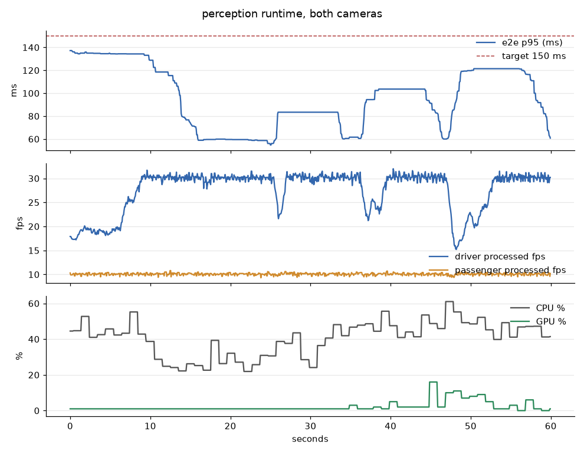

# Perception runtime with both cameras on Cristian, 2026-11-21

Generated by `scripts/benchmark.py --dual`: `perception.main` itself (one process per camera, every module of the default pipeline), 60 s measured after 15 s of model start-up. Each published frame's perf block is sampled; per-model values are the median of the rolling p50 / p95 windows.

- driver: `usb:046d:082c` 1280x720 MJPG @30; passenger: `usb:045e:076f` 1280x720 MJPG @30
- frames published: 900 (15.0 Hz, target 15.0)
- **e2e p95 96.8 ms** (max 137.2, target < 150 ms): **PASS**; degradation level max 0

## Cameras

| camera | available % | capture fps | processed fps | result age p95 ms | dropped frames |
|---|---|---|---|---|---|
| driver | 100.0 | 30.2 | 29.8 | 112.2 | 344 |
| passenger | 100.0 | 30.2 | 10.1 | 124.3 | 69 |

## Models (ms)

| camera.model | p50 | p95 | p95 max |
|---|---|---|---|
| driver.face | 8.67 | 11.12 | 12.11 |
| driver.gaze | 13.41 | 17.82 | 19.24 |
| driver.phone | 14.57 | 18.68 | 20.47 |
| driver.gesture | 15.58 | 27.48 | 33.90 |
| driver.sface | 8.30 | 18.27 | 19.53 |
| driver.monitoring_module | 1.25 | 1.92 | 2.29 |
| driver.e2e_worker | 26.79 | 53.60 | 92.49 |
| passenger.face | 8.64 | 11.40 | 12.08 |
| passenger.phone | 16.06 | 20.27 | 22.47 |
| passenger.gesture | 14.21 | 28.28 | 37.38 |
| passenger.sface | 14.16 | 21.45 | 22.25 |
| passenger.monitoring_module | 1.30 | 1.98 | 2.17 |
| passenger.e2e_worker | 20.13 | 43.77 | 61.36 |

## System

| metric | p50 | max |
|---|---|---|
| cpu | 42.3 | 61.0 |
| ram_mb | 808.8 | 822.9 |
| gpu | 1.0 | 16.0 |

