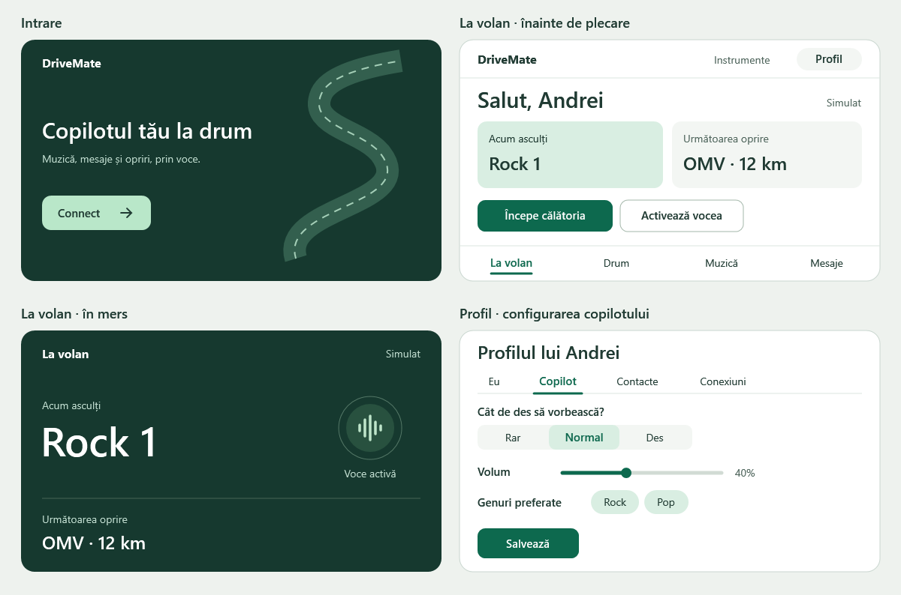

# DriveMate din perspectiva șoferului

Plan pentru revizie, 21 noiembrie 2026. La prima apăsare pe **Connect**, șoferul își configurează profilul. La următoarea conectare ajunge direct în **La volan**, unde vede piesa curentă și următoarea oprire și poate vorbi cu copilotul. **Monitorizare** deschide dashboardul complet pentru pasager sau operator.

Deciziile de produs sunt un singur profil local, acces direct prin Connect și configurarea preferințelor de interacțiune și conținut. Rutele noi de mai jos sunt propuneri pentru aplicația React existentă. Funcțiile și scenariile provin din [planul proiectului, §4–§9](../../DriveMate-PLAN-FINAL.md).

## De la Connect la sfârșitul călătoriei

1. **Intrare.** Pagina de deschidere prezintă DriveMate într-o frază și are o singură acțiune principală, **Connect**. Prima conectare deschide Profilul. Șoferul salvează numele și preferințele sau continuă cu valorile implicite. Acordul pentru notificarea contactului se dă separat, explicit. La revenire, Connect încarcă același profil.
2. **Înainte de plecare.** „Salut, Andrei” apare lângă butonul de profil. Acțiunea principală este **Începe călătoria**, cu **Activează vocea** alături. În două carduri se văd piesa curentă și următoarea oprire. Bara de navigare oferă **La volan · Drum · Muzică · Mesaje**. În Profil → Conexiuni, fiecare dispozitiv își arată propria stare după conectarea microfonului, camerelor și telefonului Android.
3. **În mers.** Meniul se restrânge la titlul melodiei, următoarea oprire și un indicator discret pentru copilot. Întrebările se aud, răspunsul se dă prin voce, cap sau gest. O alertă preia imediat semnalul și vocea. Listele de mesaje, editorul de profil, harta detaliată și istoricul se consultă la oprire. Un formular început își păstrează ciorna la plecare.
4. **La oprire.** Revine meniul complet. La un POI compatibil apare mementoul, cu opțiunile „Rezolvat” și „La următoarea oprire”. Oprirea intermediară păstrează călătoria activă. **Încheie călătoria** deschide fișa după confirmarea încheierii de către core.

Pregătirea, deplasarea și oprirea trebuie să poată fi deosebite de core. O mostră de 0 km/h, o pauză în simulator sau pierderea conexiunii sunt insuficiente pentru a deschide un formular în cursul unei călătorii. Pe ecran îngust cardurile se așază într-o coloană. Stările importante au text și simbol, iar actualizările vocale pentru accesibilitate urmăresc schimbările de stare, nu fiecare mostră de telemetrie.

## Paginile și accesul la funcții

| Destinație | Ce găsește utilizatorul | Ce poate face |
| --- | --- | --- |
| Intrare · `#/` | Numele aplicației, rolul copilotului și Connect. | Deschide profilul unic la prima folosire sau meniul la revenire. |
| La volan · `#/volan` | Piesa din `media.title`, starea vocii și următoarea oprire cu distanță ori ETA. „Muzica e oprită” corespunde unei stări confirmate. Lipsa datelor apare ca „Starea redării indisponibilă”. | Pornește sau încheie călătoria la oprire. Cardurile deschid Muzică și Drum. Copilotul primește cereri despre melodii, mesaje, mementouri, opriri și preferințe. |
| Profil · `#/profil` | Secțiunile **Eu**, **Copilot**, **Contacte** și **Conexiuni**. | Revine prin butonul Profil, modifică preferințele înainte de plecare sau la oprire și verifică ce s-a salvat. |
| Muzică · `#/muzica` | Titlul mare, artistul când există în catalog, volumul și eventuala recomandare. Titlul curent se schimbă după pornirea redării. | La oprire alege o piesă din catalogul local. În mers spune „Copilot, pune ceva rock” sau „Oprește muzica”. Un refuz al recomandării deschide oferta de quiz ori podcast dacă există conținut potrivit. |
| Drum și mementouri · `#/drum` | Traseu, poziție, ETA, următorul POI și sarcinile asociate opririlor. În mers apare doar sumarul. | Cere „Amintește-mi să iau lichid de parbriz la benzinărie”, confirmă, apoi bifează la oprire. Poate accepta pauza propusă de copilot. |
| Mesaje · `#/mesaje` | Expeditor, sursă (SMS, WhatsApp, DriveMate Contact) și progresul mesajului de la primire sau amânare până la citire și răspuns. În mers mesajul se anunță când permite core. | Autorizează citirea cu voce, dictează, ascultă răspunsul propus și confirmă trimiterea. Opțiunea „Răspunde” apare dacă notificarea permite răspunsul. |
| Fișa călătoriei · `#/rezumat` | Întâi cea mai lungă perioadă de concentrare, mesajele gestionate fără mâini și mementourile rezolvate. În detaliu apar pauzele, reacția pe canal față de referință, evoluția scorurilor, metrii orbi pe hartă, alertele A/B și efectul intervențiilor. | Revede de ce a intervenit copilotul și ce s-a măsurat după aceea. Comparația cu ultima călătorie apare când există două fișe comparabile. Poate reveni în La volan. |
| Instrumente → Monitorizare · `#/dashboard` | Pasagerul și juriul văd camerele, semnalele, scorurile, cabina, explicațiile, jurnalul, contorul A/B și performanța sistemului. | Operatorul poate ține pagina pe al doilea ecran, activa debug cu D și urmări o detecție până la decizie, răspuns și latență. |
| Instrumente → Simulator și regie · `#/simulator` | Editorul de traseu și comenzile locale existente. La integrare se adaugă scenele, oprirea la POI, ocupanții declarați, mesajul simulat, comanda LLM și redarea fluxului JSON pentru repetiție. | Operatorul pregătește scenariul și selectează sursa. Pe ecranul șoferului, datele sintetice au indicatorul „Simulat”. |
| DriveMate Contact · `/c/{token}` | Pagină separată pentru contact. Linkul sau QR-ul din Profil → Contacte îi arată starea drumului, ETA și formularul de mesaj. | Contactul poate răspunde notificării galbene de oboseală. În SOS vede alerta roșie, ora și poziția comunicată de core. Tokenul delimitează accesul la informațiile partajate. |

Din meniul La volan, **Instrumente** este o intrare secundară disponibilă la oprire. Copilotul și sesiunea audio sunt comune paginilor șoferului. Pasagerul poate primi o delegare, iar persoanele declarate în spate influențează conținutul potrivit în cabină. Șoferul gestionează profilul și mesajele personale.

## Ce se configurează în profil

| Secțiune | Control propus și efect | Legătura cu proiectul |
| --- | --- | --- |
| Eu | Numele folosit în salut și în clipul de alarmă. Starea calibrării privirii și acces la recalibrare la oprire, când P1 o oferă. | Un ID stabil identifică șoferul și profilul `profiles/<id>/profile.json`. Redenumirea păstrează ID-ul și calibrarea. Pentru o alarmă personalizată, clipul cu noul nume trebuie să fie disponibil. |
| Copilot → Interacțiune | „Cât de des să vorbească?” cu opțiunile **Rar · Normal · Des** și un control de volum. O mostră scurtă la oprire ajută la alegerea volumului. | P3 validează `talkativeness` ca `low/normal/high` și `volume` între 0 și 1. Preferința reglează intervențiile de confort în limitele politicilor P2/P3. |
| Copilot → Conținut | Genuri muzicale preferate, în ordine. Șoferul poate cere aceeași schimbare prin voce și o confirmă. | P3 citește lista `music_genres` din profil. P2 și P3 stabilesc cum actualizează aceeași listă acțiunea vocală `set_preference(music_genre)`. Modelul, furnizorul și cheile LLM țin de configurarea serviciului. |
| Contacte | Numele contactului de încredere și al celui de urgență, care pot coincide. Acord distinct pentru notificarea de oboseală și opțiunea de a fi anunțat când pleacă notificarea. | Numele și acordul aparțin profilului. Numerele sunt configurate pe server. Expeditorul sau destinatarul real apare ca notificat după rezultatul canalului respectiv. |
| Conexiuni | Sursa Simulat/Live, telefonul Android și permisiunea de microfon. Stările „Voce activă”, „Microfon indisponibil” și „Telefon deconectat” explică ce acțiuni sunt disponibile. | P4 cere microfonul după apăsarea **Activează vocea**. Telefonul folosește puntea KDE Connect. Modul demonstrativ poate fi folosit înainte de conectarea dispozitivelor. |

Propunem ca P2 să citească și să salveze profilul printr-o interfață locală, iar P4 să arate „Salvat” după confirmarea scrierii. Dacă salvarea eșuează, formularul păstrează modificările și oferă „Reîncearcă”. Acordul activ rămâne cel confirmat de server. Configurația P3 definește valorile acceptate, iar selecția muzicii citește deja gusturile șoferului. [Configurarea P3](../../assistant/config/assistant.yaml) · [Selecția pieselor](../../assistant/music.py) · [Fișa rolului P4](../../roluri/P4-dashboard-simulator-contact.md)

## Cum se aude și cum se explică o intervenție

Pe un drum monoton, P1 observă privirea, iar P2 combină contextul cu reacțiile mai lente și diferențiază dezinteresul de oboseală. Dacă P2 permite intervenția, P3 primește evenimentul, rezumatul stării și replicile recente. Alege din piesele potrivite profilului și cabinei și întreabă „Pare monoton drumul. Pun ceva rock?” Un indicator discret arată când șoferul poate răspunde. Sugestia are cel mult 15 cuvinte. Chiar și la preferința „Des”, două intervenții proactive sunt distanțate cu cel puțin 30 s.

În meniul de la oprire, eticheta copilotului trece de la „Voce activă” la „Vorbesc” și apoi la „Aștept răspunsul”, după starea audio și fereastra de dialog raportată în `interaction`. La un refuz, `assistant.muted_until` permite afișarea orei de reluare a sugestiilor. În mers, vocea și semnalul luminos transmit aceste schimbări. Monitorizarea afișează și replica integrală pentru pasager sau juriu.

După „da”, dat din cap sau 👍, core validează răspunsul, execută acțiunea confirmată și transmite comanda de redare. Când începe redarea, titlul apare în **Acum asculți**. Refuzul sau expirarea întrebării închide propunerea. În fișa de la final, șoferul poate deschide recomandarea și vedea observația P2, sugestia acceptată și efectul măsurat. De exemplu, fișa poate arăta „Ai acceptat o piesă rock. După redare, dezinteresul a scăzut”, dacă măsurătorile susțin afirmația. În timpul măsurării apare „Efect în curs de măsurare”. În Monitorizare, aceeași secvență include sursa **REGULĂ** sau **LLM**, ora și canalul răspunsului.

| Situație | Ce trăiește șoferul | Condiție sau rezultat verificabil |
| --- | --- | --- |
| Voce și manevre | „Copilot” deschide cererea. După o întrebare se poate răspunde direct. La privirea în oglindă vocea se oprește și reia când manevra s-a terminat. | Vocea este half-duplex. `speak_done` deschide fereastra de 6 s. O replică transmisă în streaming se aude o singură dată. |
| Cabină și cauză | În timpul unei conversații, copilotul lasă loc ocupanților. Dacă pasagera ține telefonul și șoferul privește repetat spre ea, copilotul i se adresează direct. „Maria, îi poți povesti tu?” | P2 atribuie telefonul pasagerei și corelează privirile șoferului folosind ambele camere. Când pasagera doarme, muzica se dă încet și mesajele personale sunt disponibile pe ecran la oprire. |
| Mesaj | La risc ridicat mesajul așteaptă. Cu pasager la bord se aude „Mesaj personal de la Mihai. Îl citesc?” Apoi șoferul dictează răspunsul și aude „Ajung în 20 de minute. Trimit?” | Citirea respectă regula F2. Răspunsul se expediază numai după confirmare și apare ca trimis după rezultatul punții. Fără conexiune apare posibilitatea de reîncercare la oprire. |
| Oboseală și refuz | La oboseală, copilotul întreabă „Cât de obosit ești, de la 1 la 9?” și poate propune oprirea aleasă de core, inclusiv o benzinărie pentru un memento activ. „Lasă-mă în pace” suspendă intervențiile de confort. | Când sunt îndeplinite condițiile C10 (inclusiv acordul și intervalul dintre notificări), regula notifică persoana de încredere prin SMS și DriveMate Contact. Răspunsul ei urmează regula F2 și poate fi urmat de o singură propunere de oprire. |
| Memento la POI | „Ai zis să iei lichid de parbriz.” 👍 îl bifează. 👎 îl păstrează pentru următoarea oprire potrivită. | P2 declanșează șablonul la oprire confirmată și la un POI din categoria acceptată. Apropierea sau pauza în simulator nu înseamnă sosire. |
| Alertă și SOS | Semnal discret, voce, apoi alarmă după nivel. La microsomn se aude clipul cu numele șoferului, apoi „Ești bine?”. Dacă șoferul nu răspunde, urmează numărătoarea și instrucțiunile fixe pentru pasager. | Regulile P0–P2 au prioritate față de muzică și dialog. Core raportează separat apelul către contactul de urgență, SMS-ul cu locația și alerta din pagina Contact. Pierderea camerei șoferului produce „Nu te mai văd”. |
| LLM lent, oprit sau indisponibil | În context permis, o formulare fixă oferă răspunsul de rezervă. La o alertă critică intră direct clipul local. | P3 are termen de 2,5 s și întoarce cel mult trei acțiuni admise. Core validează permisiunea și confirmările înainte de execuție. În jurnal, textul de rezervă are sursa REGULĂ și motivul disponibil. |

## Ordinea de implementare și probele de acceptare

Astăzi există dashboardul React, editorul de traseu cu previzualizare JSON locală, un exemplu de stare P3, catalogul, dialogul și modulul de voce. În acest checkout, profilurile, core-ul canonic și aplicația Contact sunt încă de implementat. În catalog sunt șase piese, cu artist necompletat și fără intrări de podcast sau piese marcate `kid_safe`. Cu un copil declarat în cabină și catalogul actual, copilotul poate propune un quiz. [Starea de exemplu](../../tests/assistant/fixtures/state_example.json) · [Catalogul](../../assistant/data/media_catalog.json) · [Interfața P3](../assistant.md)

| Ordine | Livrare și responsabilitate | Probă înainte de etapa următoare |
| --- | --- | --- |
| 1 | **Intrare, profil, La volan.** P4 introduce rutele și o sesiune comună pentru sursă, audio și navigare. P2 definește citirea/scrierea profilului și starea călătoriei. P3 confirmă aplicarea preferințelor salvate. | Profil nou → Connect → salvează → redeschide → același profil. Refuzul microfonului păstrează accesul la meniu. Test și pe ecran îngust, la zoom 200% și din tastatură. |
| 2 | **Muzică și copilot.** P4 leagă meniul de `media`, `interaction` și evenimentele de pe `/ws/ui`. P2/P3 leagă propunerea, confirmarea, execuția și rezultatul. P3/P4 activează redarea audio printr-un gest înainte de plecare și gestionează separat permisiunea de microfon. | În scena 5, acceptarea produce o singură redare și același titlu pe ambele pagini. Navigarea păstrează sunetul. Se verifică și alarma cu microfonul refuzat. Doar ecranul audio al șoferului confirmă `speak_done` și `alarm_played` când operatorul urmărește sesiunea pe al doilea ecran. |
| 3 | **Drum, mesaje și cabină.** P4 adaugă sumarul traseului, mementourile și Mesaje. P2 furnizează POI, oprirea și stările confirmate. P3 conectează dialogul la puntea Android. P1 furnizează gesturile și semnalele camerelor. | În scenele 1, 3, 4 și 7 se verifică mementoul confirmat o singură dată, mesajul amânat și apoi trimis cu acordul șoferului, cauza atribuită pasagerului și mementoul rezolvat la POI. |
| 4 | **Alerte și Contact.** P2 publică prioritățile, întreruperile, numărătoarea și rezultatele pe canal. P3 livrează vocea, clipurile și SMS-ul. P4 afișează pe pagina cu token starea normală, notificarea de oboseală sau SOS. | Scenele 2, 6, 8 și 9 acoperă camera pierdută, refuzul cu și fără acord pentru notificare, alarma cu LLM oprit și SOS către contactul de demo. O livrare eșuată este raportată pe canalul afectat. |
| 5 | **Fișă, Monitorizare și regie.** P2 furnizează sumarul final și comparațiile disponibile. P4 leagă fișa, harta, scenele și instrumentele existente la aceeași sesiune. | În scena 10, fișa corespunde evenimentelor și metrii orbi apar pe segmentele măsurate. Resetarea simulatorului păstrează conexiunea Live și jurnalul. |

**De convenit cu P2/P3 înainte de integrarea Live.** Fișa are nevoie de identificarea călătoriei, a opririi și a finalizării ei. Profilul are nevoie de citire, salvare și confirmarea aplicării preferințelor. Mesajele, media și notificările au nevoie de un rezultat care poate fi asociat cererii, inclusiv la reconectare. Evenimentele care explică o intervenție trebuie asociate cu cauza, sursa și efectul măsurat. La date expirate, UI arată ultima actualizare și retrage comenzile dependente de starea vehiculului. Harta pentru șofer așteaptă poziția și POI-urile de la sursa aleasă de core. [Propunerea pentru simulator și P2](dashboard-react-typescript.md#contract-de-integrare-simulator--p2--21-noiembrie-2026)

**Acoperirea planului.** A și B alimentează monitorizarea, explicațiile și fișa. C guvernează toate paginile în călătorie. D și E dau voce copilotului. F și G se văd în Mesaje, Contact și comportamentul în cabină. H și I sunt instrumentele operatorului. J1–J3 apar în Monitorizare și în fișă, J4 este benchmarkul pentru prezentare. K se urmărește în Drum, la oprire și în fișă.

**Extensiile S intră după funcțiile obligatorii.**

- **Monitorizare și regie** primesc privirea spre spate, fiabilitatea oculară, gestul pasagerului și jurnalul sesiunii (AS13–14, AP6, J5).
- **Copilot și Muzică** primesc sondarea rară, explicația vocală la cerere, întreruperea vocii de către șofer, identificarea vorbitorului și conținutul pentru copil (B5, D5b, E2, E4, G4).
- **Mesaje și Contact** primesc apelul de pe telefon și participarea juriului prin QR (F4, F7). **Drum** adaugă propunerea la apropierea de un POI și mementourile la destinație sau la orice oprire (K4–K5).
